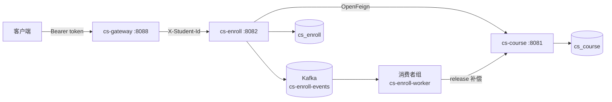
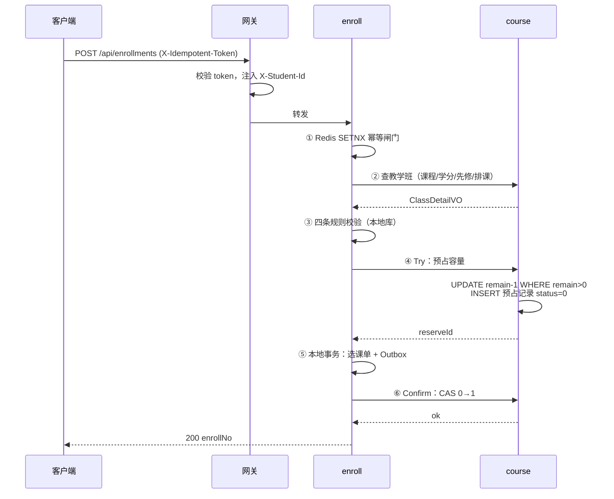

# 选课系统 · 微服务


> **容量在课程服务、选课单在选课服务，跨服务怎么保证「选了就真的选上了」？**
>
> 答案不是上一套 Seata，而是 **预占 → 确认 → 取消 + 定时对账**，并且把每一步的失败路径都想清楚：
> 悬挂、空回滚、重复确认、远程超时、消费者挂掉。

一个人写的项目，3000 行，重点在**一致性设计**，不在体量。

---

## 架构



**边界按数据归属划**，不按技术分层：课程/容量归 course，选课单/学分归 enroll，两个独立库，**没有一张表被两个服务直接读写**。

---

## 一次选课发生了什么



失败路径才是重点：

| 在哪一步失败 | 怎么处理 |
|---|---|
| ④ 远程超时，不知道对方成没成 | 允许留下「没人确认的预占」，由对账释放 |
| ⑤ 本地落单失败 | 调 Cancel 回滚预占 |
| ⑥ Confirm 失败 | 本地改回 + Cancel，两边都当没选 |
| Cancel 先到、Try 后到（**悬挂**） | 落「墓碑」记录（status=2），Try 读到即返回已取消，不再扣容量 |
| Try 没到就收到 Cancel（**空回滚**） | 同上，墓碑挡住后续 Try |

---

## 三个设计点

### 1. 用状态机 CAS 代替分布式锁

```sql
UPDATE t_capacity_reserve SET status = #{to}
WHERE reserve_id = #{id} AND status = #{from}
```

影响行数为 0 就说明状态已经变了——重复 Confirm、重复 Cancel 自然被挡住，不需要额外加锁。

### 2. Outbox + Kafka 是两层，不是二选一

- **Outbox** 解决「业务提交了但消息丢了」：消息与业务**同事务**落库
- **Kafka** 解决「投递与消费解耦、多消费方、削峰」

投递链路：中继 5 秒扫表 → `acks=all` 发 Kafka → 消费者组**手动 ACK** → Redis 去重 → 失败指数退避 → 超限进死信 topic。

没装 Kafka 也能跑：`--cs.mq.enabled=false`，Outbox 退化成直接调下游。

### 3. 退课「先本地后远程」

```
本地事务：选课单 status 1→0 + 落 Outbox 补偿消息
    ↓ 再调远程 release
```

反过来（先放容量再改单）如果本地失败，会出现「容量放了但单还在」→ **可能超卖**。

现在这个顺序最坏只是「单退了容量没还」→ 浪费容量，但**不会错卖**。

> 宁可少卖，不可超卖。

---

## 30 秒跑起来

```bash
# 0. 建库（两个独立库）
mysql -uroot -p --default-character-set=utf8mb4 -e "source sql/01_course.sql"
mysql -uroot -p --default-character-set=utf8mb4 -e "source sql/02_enroll.sql"

# 1. 打包（需要 JDK 17）
mvn -DskipTests package

# 2. 起三个服务
./start.ps1            # Windows
# 或分别 java -jar cs-*/target/*.jar

# 3. 可选：起 Kafka（用 MQ 模式）
./kafka-start.ps1
```

验证：

```bash
curl -X POST http://localhost:8088/api/auth/login -H "Content-Type: application/json" \
     -d '{"studentId":1001,"name":"张三"}'
# → {"code":0,"data":{"token":"...","studentId":1001}}
```

详细步骤、冒烟顺序、Windows 上的 Kafka 坑：[docs/05-启动与调试](docs/05-启动与调试.md)

---

## 容器化部署

```bash
mvn -DskipTests package          # 先构建 jar（镜像只负责运行）
docker compose up -d --build     # MySQL + Redis + Kafka + 三个服务
docker compose ps
```

**实测结果**（CentOS 7 虚拟机，2C 3.7G）：

| 容器 | 镜像 | 状态 | 端口 | 内存 |
|---|---|---|---|---|
| cs-mysql | mysql:8.0 | healthy | 3307→3306 | 342 MB |
| cs-redis | redis:7-alpine | healthy | 6379 | 15 MB |
| cs-course | course-selection-cs-course | Up | 8081 | 236 MB |
| cs-enroll | course-selection-cs-enroll | Up | 8082 | 249 MB |
| cs-gateway | course-selection-cs-gateway | Up | 8088 | 199 MB |

**五个容器合计约 1 GB**，一条 `docker compose up -d` 拉起全套，容器内通过服务名互访（`mysql:3306`、`kafka:9092`、`http://cs-course:8081`），宿主机只需访问 `localhost:8088`。

镜像设计：

- **jar 在宿主机构建，镜像只负责运行** —— 构建工具链不进生产镜像
- **非 root 用户运行** —— 容器逃逸时降低影响面
- **`-XX:MaxRAMPercentage=70`** —— JVM 跟随容器内存限制，而不是读宿主机的
- **healthcheck + `depends_on: condition`** —— MySQL 就绪后才起业务服务，避免启动即报错

> 说明：本机 Kafka 是用静态二进制跑的（CentOS 7 的 yum 源已失效），
> `bitnami/kafka` 容器镜像在受限网络下未能拉取，compose 里已写好配置，
> 用 `docker-compose.override.yml` 可临时关闭 MQ 只验证其余五个容器。

---

## 验证过的场景

| 场景 | 结果 |
|---|---|
| 正常选课 | ✅ 预占 status 0→1，容量 -1 |
| 同一幂等 token 重放 | ✅ `3001` 拒绝，不重复扣容量 |
| 容量 1 的教学班，第二人抢 | ✅ `2003` 容量不足 |
| 缺先修课 | ✅ `3004` |
| 同课程换教学班 | ✅ `3001` |
| 时间冲突 | ✅ `3003` |
| 退课 | ✅ 容量回补，Kafka 消费后释放 |
| **停掉 course 服务后退课** | ✅ 快速通道失败 → 中继投 Kafka → 消费失败重试 → 服务恢复后补做释放 |
| 预占超时未确认 | ✅ 对账扫描 → CAS 0→3 → 容量回补 |
| 手动造墓碑 + 后到 Try | ✅ 返回已取消，不扣容量 |
| **Docker Compose 部署** | ✅ 五容器启动，从宿主机调 `192.168.91.128:8088` 完成登录/查课/选课 |

---

## 文档

| # | 文档 | 内容 |
|---|---|---|
| 0 | [怎么读这个项目](docs/00-怎么读这个项目.md) | 三条路线，按问题找代码 |
| 1 | [架构与拆分](docs/01-架构与拆分.md) | 边界怎么划、四个一致性方案怎么选、三个已知弱点 |
| 2 | [核心链路时序](docs/02-核心链路时序.md) | 选课/退课/对账/Outbox，含失败路径表 |
| 3 | [接口清单](docs/03-接口清单.md) | 7 个对外 + 6 个内部接口，改哪张表 |
| 4 | [面试问答 20 题](docs/04-面试问答-20题.md) | 面试官从哪挖、怎么答（含 MQ 四问） |
| 5 | [启动与调试](docs/05-启动与调试.md) | 命令、冒烟顺序、常见错误、改代码实验 |

---

## 取舍与已知弱点

| 决定 | 为什么 | 代价 |
|---|---|---|
| 不引入 Seata，手写补偿 | 想清楚补偿逻辑本身，且不锁全局行 | 要自己处理悬挂、空回滚 |
| 容量用条件更新扣减 | 判断和修改在一条 SQL 里，无窗口 | 热点行仍是瓶颈（可上 Redis 预扣） |
| 规则校验放 enroll 侧 | 规则要读选课表，放 course 会双向依赖 | enroll 要多存快照字段 |
| 本地用 static discovery | 不装 Nacos 也能跑 | 换机器要改配置 |
| 对账 30 秒轮询 | 实现简单，够用 | 最坏 30 秒才释放 |

**没做**：服务治理（限流/熔断/链路追踪）、分库分表、真实压测。这些是下一步，不是不知道。
